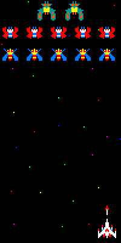
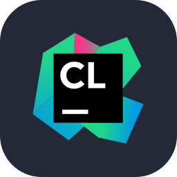
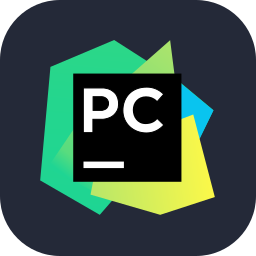

<h1> Hiya! I'm Daniel </h1>

  
  

    <i> A gif showcasing the classic 1981 arcade shooter video game developed and published by Namco, which happens to be my favorite game of all time!</i>
  

 
<!-- Introduction -->
## 👨‍💻 About Me 👨‍💻

- A Florida Gulf Coast University (FGCU) new graduate, who majored in Software Engineering. 
- Foundational background in backend development using C/C++, Java, and Python. Additionally, I've worked with the Arduino Uno R3 microcontroller using C++ and Assembly.
- Continuing to work and improve my full-stack related skills, with the eventual goal to become a software engineer. 
- Thank you for stopping by! And please feel free to message me, I'd love to chat! Bye!

<!-- Projects currently working on -->
## 🚧 What I'm Currently Working On 🏗️

<!-- Needle Of Time -->
<h3>
  <a href="https://github.com/danieljlowry/Needle_Of_Time_PUBLIC">
    Needle Of Time 
  </a>
  🪡
</h3>

- 2D video game platformer 
- A mysterious shadowy figure is attempting to unravel the very threads of time itself
- The time administration's (literally) holier-than-thou director sends the player character out to extinguish the threat and save time itself
- The player must travel across the past, present, and future, facing various enemies from each in order to preserve the steady flow of time 
- Serves as both a personal project of mine as well as my introduction into game development, utilizing the Godot engine and the gdscript language

<!-- Portfolio Website -->
<h3>
  <a href="https://github.com/danieljlowry/Daniel-Lowry-Portfolio-Website">
   Portfolio Website
  </a>
  🖥️
</h3>

- Your standard issue portfolio website you'd see on other developer's profiles
- Includes a small intro and background about myself
- Lists my academic career, acheivements, events, etc
- As well as showcasing my class, personal, and event projects

<!-- Shhhh!! Secret! -->
<h3> 
  <a href="assets/question_mark.png">
  ???
  </a>
  (x2) 🤫
</h3>

  
- Two more secretive projects  
- Godot & React related  
- Hope to be able to talk about (relatively) soon...
- Stay tuned for updates!
  

<!-- Technology List: Frontend, Backend, Database, Game Engines -->
## 🛠️ Technical Stack ⚙️

**Frontend**

      
      
      
      
      

**Backend & Databases**

 

      
      
      
      
      

**Developer Tools**

      
      
      
      
      
      
      
      
      
      

**Game Engines**

      

<h3  align="center">💻 Thanks again for stopping by & check out my repos, if you have the chance ⬇️ </h3>
